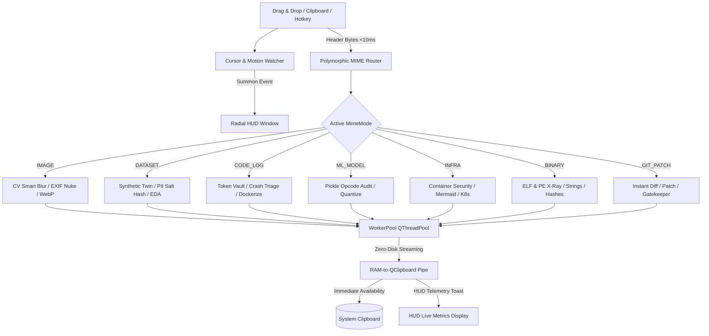
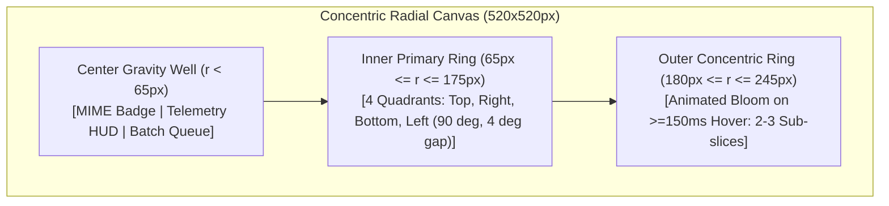
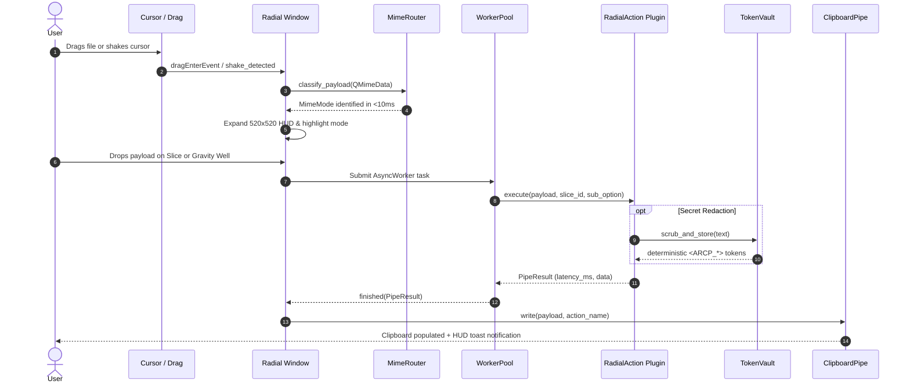

# ArcP: Autonomous Radial Context Pipeline
**Author:** Rahul Chandra Padamuttam (RCP)  
**CLI Executable Name:** `arcp`  
**Target Architecture:** 60-FPS Frameless Polymorphic Radial Desktop Firewall, Edge-AI Sanitizer, and In-Memory DevSecOps Pipeline.

[](https://python.org)
[](https://riverbankcomputing.com/software/pyqt/)
[](#zero-disk-footprint-guarantee)
[](#license)

---

## 1. System Overview

**ArcP** is an ultra-low latency, polymorphic context pipeline and radial desktop firewall built on PyQt6. It intercepts files, text, images, and binary streams dragged onto a 60-FPS HUD or floating seed, instantly classifies them via header magic bytes in `<10ms`, and executes cryptographic redaction, PII sanitization, synthetic data generation, or threat audits strictly in RAM.



---

## 2. Mathematical & UI Engine Architecture

### 2.1 Polar Collision Geometry & Donut Sector Rendering
ArcP converts Cartesian coordinates $(x, y)$ relative to the window center $(x_c, y_c)$ into polar coordinates $(r, \theta)$ to resolve collisions against concentric sectors with precision anti-aliasing:

* **Radius Calculation:**
  $$r = \sqrt{(x - x_c)^2 + (y - y_c)^2}$$
* **Normalized Angle:**
  $$\theta = (\text{degrees}(\text{atan2}(y - y_c, x - x_c)) + 360) \bmod 360$$



### 2.2 Reversible Redaction Vault with Shannon Entropy
`TokenVault` computes the Shannon entropy $H(X)$ to classify high-entropy secrets and API tokens:

$$H(X) = -\sum_{i=1}^{n} P(x_i) \log_2 P(x_i)$$

When $H(X) > 4.2$ or when known credential patterns (AWS, GitHub, JWT, IPv4/6, Emails, Phones) are identified:
* **Dehydrate:** Converts secrets into `<ARCP_SECRET_n>`, `<ARCP_IP_n>`, `<ARCP_EMAIL_n>` and stores bidirectional mappings in an encrypted RAM table with a 600-second (10-minute) TTL.
* **Re-Hydrate:** Replaces `<ARCP_*>` tokens in incoming LLM responses with their exact original values.

---

## 3. The 7 Polymorphic Operational Modes

| Mode | Target Payloads | Primary Radial Slices |
|---|---|---|
| **`IMAGE`** | `.png`, `.jpg`, `.webp`, `.bmp`, raw clipboard image | **S1:** CV Smart Blur<br>**S2:** Stego & EXIF Nuke (LSB $\pm 1$ perturbation)<br>**S3:** Tensor / OCR Extract<br>**S4:** WebP Ultra-Compress (Lossless / Quantized / Data URI) |
| **`DATASET`** | `.csv`, `.tsv`, `.parquet`, `.json`, `.sqlite` | **S1:** Synthetic Twin (100-row statistically identical twin)<br>**S2:** PII Masking (Salted SHA-256 preserving join keys)<br>**S3:** Instant EDA HTML Profile (Self-contained dark mode)<br>**S4:** Format Transpile (JSON / SQLite / Markdown) |
| **`CODE_LOG`**| `.log`, `.txt`, `.py`, `.js`, `.ts`, `.env`, raw code | **S1:** Secret Scrub (Dehydrate to RAM vault)<br>**S2:** Re-Hydrate / Crash Triage (Stack trace context & dedup)<br>**S3:** Schema Gen (Pydantic v2 / TypeScript / C++20)<br>**S4:** Auto-Dockerize (Hardened multi-stage non-root) |
| **`ML_MODEL`**| `.pt`, `.pth`, `.onnx`, `.safetensors`, `.pkl` | **S1:** Pickle & Malicious Opcode Audit (`pickletools`)<br>**S2:** Architecture & Tensor Inspector<br>**S3:** Dynamic Weight Quantize (FP32 $\rightarrow$ FP16 / INT8)<br>**S4:** Benchmarking Inference Wrapper Gen |
| **`INFRA`**   | `Dockerfile`, `docker-compose.yml`, `.tf`, `.yaml` | **S1:** Container Security Audit (Root / Ports / Tags)<br>**S2:** Mermaid.js Architecture Generator<br>**S3:** K8s Manifest Converter (`Deployment` + `Service`)<br>**S4:** Env Template Extractor (`.env.example`) |
| **`BINARY`**  | `.exe`, `.dll`, `.so`, `.elf`, `.bin` | **S1:** ELF / PE Header X-Ray (Pure Python struct parsing)<br>**S2:** Strings & Threat IOC Extractor<br>**S3:** Symbol & Shared Library Audit<br>**S4:** Hashes & Shannon Byte-Entropy Packer Detection |
| **`GIT_PATCH`**| `.diff`, `.patch`, `.git` directory | **S1:** Instant Unified Diff vs Clipboard<br>**S2:** `git apply` Patch Bundler with Diffstat<br>**S3:** Conventional Commit Message Generator<br>**S4:** Pre-Commit Gatekeeper (AST + Secrets + Debuggers) |

---

## 4. High-Definition Cyber Icon Engine & Asset Registry

ArcP includes a custom, dedicated vector icon suite designed specifically for cyberpunk dark-glass HUD aesthetics, eliminating reliance on OS-dependent Unicode emoji fonts and preventing Windows `cp1252` encoding exceptions:

* **Location:** `assets/icons/` & `ui/icons.py`
* **Zero-Disk In-Memory Caching:** Built-in `IconRegistry` provides zero-disk RAM caching of high-resolution SVGs, multi-resolution `QIcon` objects (16 to 128px), and base64 SVG data URIs for self-contained HTML reports.
* **Console Safety:** Automatically maps visual icons to safe ASCII bracketed tags (e.g. `[ZAP]`, `[QUEUE]`, `[SECURE]`, `[ALERT]`, `[OK]`, `[BLOCK]`, `[SEARCH]`, `[XRAY]`, `[VAULT]`, `[DEMO]`) for terminal environments.

| Icon Asset | Visual Identity | Function & Pipeline Stage |
|---|---|---|
| `zap.svg` / `.png` | Electric Neon Cyan Lightning Bolt | Live Clipboard Stream & High-Velocity Batch Processing |
| `package.svg` / `.png` | Isometric Cyber Cargo Crate | Gravity Well Batch Queue Buffer |
| `shield.svg` / `.png` | Hexagonal Neon Aegis | Cryptographic Gatekeeper, Pre-Commit Audit, & Infrastructure Defense |
| `alert.svg` / `.png` | Amber Hazard Warning Triangle | Security Threat Intercept & Crash Triage Alerts |
| `check.svg` / `.png` | Emerald Geometric Checkmark | Policy Verification & Exploit Mitigation Pass |
| `cross.svg` / `.png` | Crimson Neon Security Block | Exception Intercept & Policy Violation Blocker |
| `search.svg` / `.png` | Digital Forensic Radar Loupe | Deep IOC Extraction & Network Endpoint Scanner |
| `microscope.svg` / `.png` | Forensic Hexagonal X-Ray | Binary Header Struct Inspection (ELF / PE32+) |
| `lock.svg` / `.png` | Quantum Cryptographic Padlock | Token Vault Reversible Redaction & Hash Manifest |
| `sparkle.svg` / `.png` | Cyber Diamond 4-Point Star | Polymorphic Showcase & Demo Rotation |
| `arcp_logo.svg` / `.png` | Concentric Radial HUD Badge | System Tray & Application Window Branding |

---

## 5. Zero-Disk Footprint Guarantee

ArcP operates with a **strict 0-byte temporary file policy**:
1. All image processing uses `PIL.Image.open(io.BytesIO)` and `cv2.imdecode` / `cv2.imencode`.
2. All dataset transformations execute directly on in-memory `pd.DataFrame` and `sqlite3.connect(":memory:")`.
3. All clipboard output is streamed straight into `QApplication.clipboard()` without writing to `C:\Temp` or `/tmp`.

---

## 6. Quickstart & CLI Commands

### Installation
```bash
git clone https://github.com/rahulchandra2004/ArcP.git
cd ArcP
pip install -r requirements.txt
pip install -e .
```

### CLI Launch Modes
```bash
# 1. Interactive Bloomed Radial HUD (Frameless 60-FPS Overlay)
python main.py
# or global CLI executable:
arcp

# 2. Standard Windowed Desktop Mode (With title bar and window frame)
python main.py --windowed
# or:
run_arcp_windowed.bat

# 3. Daemon Mode (Floating edge seed with Ctrl+Shift+Space & cursor shake detection)
python main.py --daemon

# 4. Automated Visual Showcase Demo (Cycles through all 7 polymorphic modes)
python main.py --demo
```

### Running Unit Tests
```bash
pytest tests/test_pipeline.py -v
```

---

## 6. Architecture & Data Flow



---

## 7. Author & Credits
- **Architect & Engineer:** Rahul Chandra Padamuttam (RCP)
- **License:** MIT License
